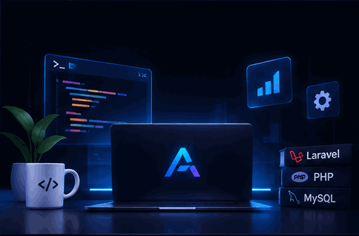

<h1 align="center">Hi 👋, I'm Amirhossien Imanpur</h1>

<h3 align="center">
    Developer • System Builder • Analytical Thinker
</h3>

<p align="center">
    
    
    
</p>

---

## 👨‍💻 About Me

I'm a developer with 4 years of hands-on programming experience, passionate about building software, designing systems, and solving real-world problems.

I don't just focus on writing code. I enjoy understanding how things work, analyzing problems, designing efficient solutions, and turning ideas into functional digital products.

My interests go beyond software development into business strategy, branding, marketing, and automation.

```php
<?php

class Amirhossien
{
    public string $name = "Amirhossien Imanpur";
    public string $location = "Tabriz, Iran";
    public int $experience = 4;

    public array $focus = [
        "Software Development",
        "System Architecture",
        "Business Analysis",
        "Brand Building",
        "Marketing & Growth",
        "Automation",
    ];

    public array $mindset = [
        "Think analytically",
        "Build systems, not just features",
        "Solve real problems",
        "Improve every day",
    ];

    public function philosophy(): string
    {
        return "Understand. Analyze. Build. Improve.";
    }
}
```

- 💻 4 years of practical programming experience.
- ⚙️ Building web applications and modular software systems.
- 🧠 Interested in analytical thinking and problem-solving.
- 📊 Passionate about business processes and system optimization.
- 🚀 Interested in branding, marketing and digital business development.
- 🤖 Using AI as a development assistant alongside my programming knowledge.
- 🔥 Consistently coding, learning and contributing to GitHub.

---

## 🚀 What I Build

<p align="center">
    
</p>

<p align="center">
    <b>Think Beyond Code • Build Systems • Create Value</b>
</p>

---

## 🧩 Areas of Interest

| Field | Focus |
|---|---|
| Software Development | Building practical digital products |
| System Building | Modular and scalable architectures |
| Business Analysis | Understanding problems and workflows |
| Automation | Optimizing repetitive processes |
| Branding | Building and developing digital brands |
| Marketing | Strategy, content and business growth |
| AI-Assisted Development | Improving development productivity |

---

## 🛠️ Tech Stack

### Backend Development

<p>
    
</p>

### Frontend Development

<p>
    
</p>

### Tools & Environment

<p>
    
</p>

### Automation & AI

<p>
    
    
</p>

---

## ⚙️ My Development Approach

```text
01. Understand the Problem
          ↓
02. Analyze Requirements
          ↓
03. Design the System
          ↓
04. Develop the Solution
          ↓
05. Test & Improve
          ↓
06. Maintain & Scale
```

I care about:

- Clean and maintainable code
- Modular architecture
- Reusable services and components
- Database design and optimization
- Security and performance
- Real business requirements
- Continuous improvement

---

## 📈 My GitHub Journey

<p align="center">
    
    
</p>

<p align="center">
    <b>Learning • Building • Improving • Repeating</b>
</p>

---

## 🌐 Connect & Explore

<p align="center">
    <a href="https://github.com/amirhoseniliw">
        
    </a>
    <a href="https://temiliw.ir">
        
    </a>
</p>

---

<p align="center">
    <b>Think Beyond Code.</b>
    <br>
    Build Systems. Create Value. 🚀
</p>
